<div align="center">

# SwitchMap

**Switch inventory and network monitoring in one web app — port maps, SNMP, topology, alerts.**

English · [Русский](README.ru.md)


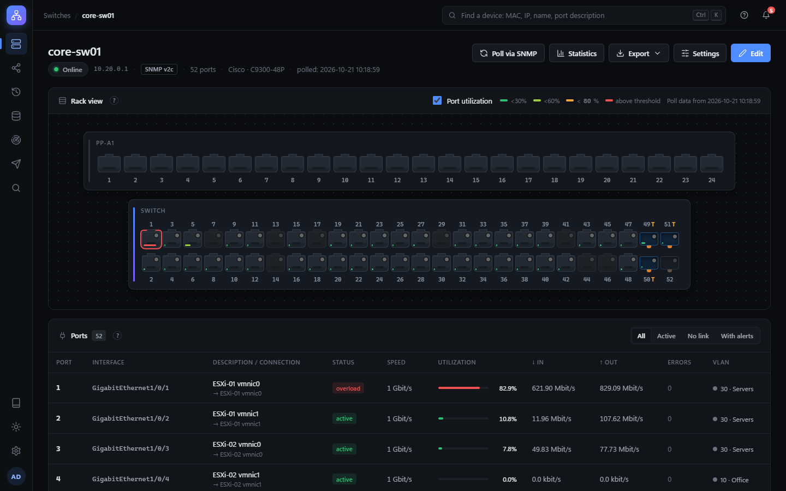

</div>

SwitchMap keeps a picture of your access layer that is always up to date: which device is plugged into which port,
which ports are overloaded or throwing errors, how switches are linked together, and who changed what.
It polls switches over SNMP, draws them as they look in the rack and sends alerts to Telegram or email.

It installs as a regular service on Windows or Linux, works without internet access, and needs no
database server, Python or other prerequisites.

## Contents

- [Features](#features)
- [Screenshots](#screenshots)
- [Supported equipment](#supported-equipment)
- [Installation](#installation)
- [Configuration](#configuration)
- [Updating, backups and moving to another server](#updating-backups-and-moving-to-another-server)
- [Documentation](#documentation)
- [Development](#development)
- [License](#license)

## Features

**Port map and inventory**
- Switches and patch panels drawn as in the rack: RJ-45 and SFP ports, one or two rows, trunks.
- Connections «switch port → patch panel port → device» with cable colors and descriptions.
- VLANs on ports with colors, port descriptions from the switch (ifAlias), PoE status and power.
- Export to Excel, CSV and a printable PDF datasheet for every switch or the whole inventory.

**Monitoring**
- SNMP v2c and v3 (MD5, SHA-1…SHA-512; DES, 3DES, AES-128/192/256), periodic polling on a schedule.
- Port status, speed, traffic in/out, utilization and errors; CPU, memory and temperature of the switch.
- History charts from one hour to a year: raw data is kept for a week, then rolled up into hourly averages and peaks.
- Alerts when a switch goes down, a port drops or flaps, utilization or errors exceed a threshold,
  CPU or temperature are too high — with a notification when things return to normal.

**Finding devices**
- One search box for MAC, IP, host name, port description and connection labels (<kbd>Ctrl</kbd>+<kbd>K</kbd>).
- The result is a switch and port; links between switches (uplinks) are recognized and shown separately.

**Topology**
- Network map built from LLDP: switches, links with port numbers, unknown neighbors (access points, firewalls)
  and devices assigned to ports.

**Notifications**
- Telegram (bot, several chats, proxy or self-hosted Bot API) and email (Gmail, Yandex, Mail.ru, Outlook or your own SMTP).
- Batching into one message per poll, quiet hours, «important ports only», flap suppression, retries after network errors.

**Discovery and import**
- Scan networks and ranges over SNMP, follow LLDP neighbors and add found switches in one click.
- Import switches from NetBox and keep names and addresses in sync.

**Data and security**
- Users with administrator and viewer roles, login throttling, CSRF protection, strict Content Security Policy.
- SNMPv3, mail, Telegram and NetBox passwords are stored encrypted.
- Change log with undo: every change of switches, connections, settings and users; deleted switches can be restored.
- Automatic daily backups of the database, restore in one click.

**Usability**
- Interface in six languages: English, Russian, Chinese, Spanish, German and French —
  chosen automatically from the system language, switchable in the profile menu.
- Built-in knowledge base (16 articles in every language) and «?» hints next to fields: what SNMP is, how to enable it
  on a particular vendor, what to do when something does not work.
- Dark and light themes, works on phones and tablets.
- Daily check for new versions (can be turned off; nothing is downloaded or installed automatically).

## Screenshots

<table>
<tr>
<td width="50%">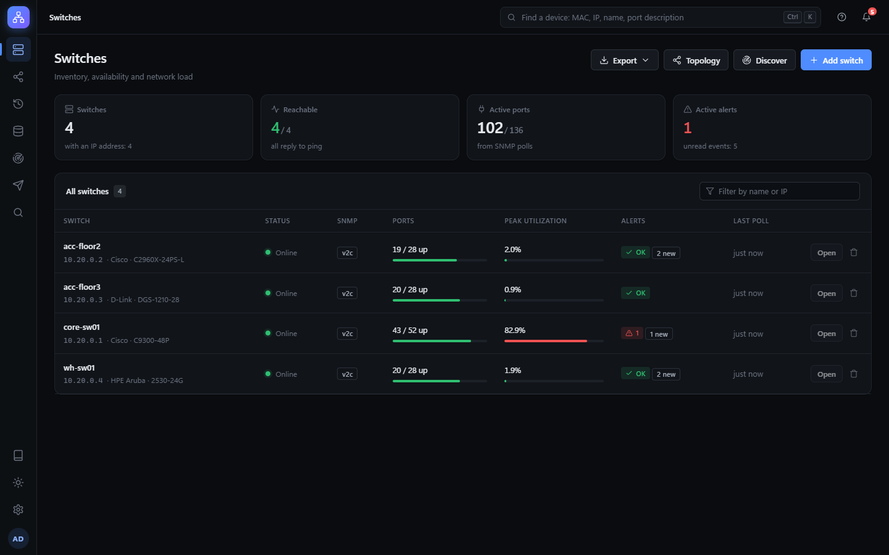<br><sub><b>Dashboard</b> — availability, active ports, peak utilization and alerts of all switches</sub></td>
<td width="50%">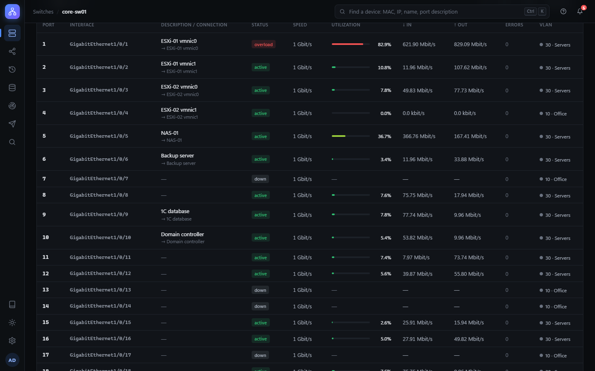<br><sub><b>Port table</b> — status, speed, traffic, utilization, errors and VLAN of every port</sub></td>
</tr>
<tr>
<td>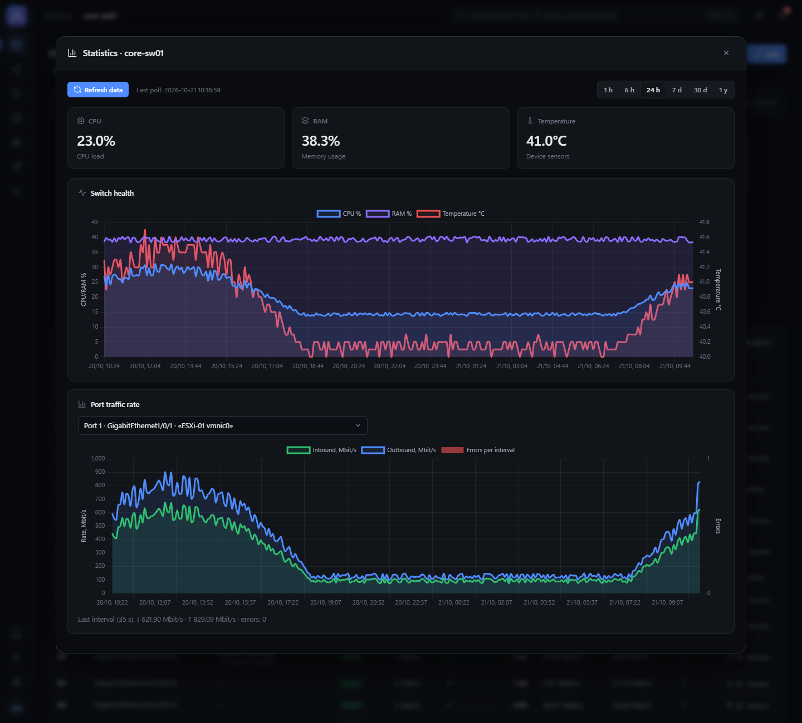<br><sub><b>Statistics</b> — CPU, memory, temperature and port traffic over time</sub></td>
<td>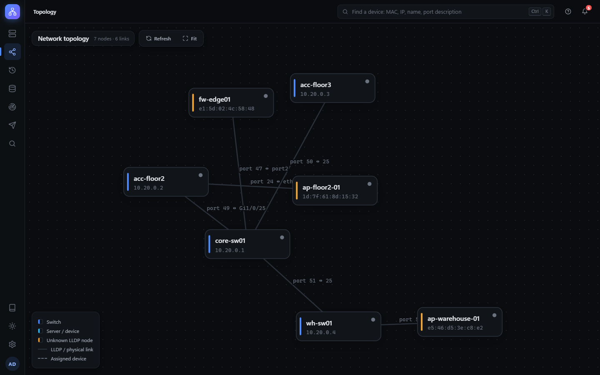<br><sub><b>Topology</b> — LLDP links between switches and unknown neighbors</sub></td>
</tr>
<tr>
<td>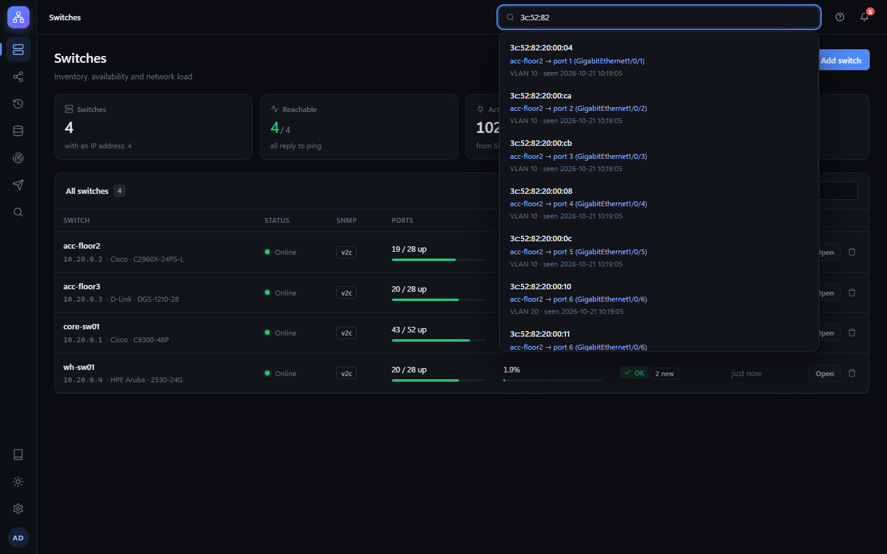<br><sub><b>Search</b> — where a MAC, IP or name is plugged in</sub></td>
<td>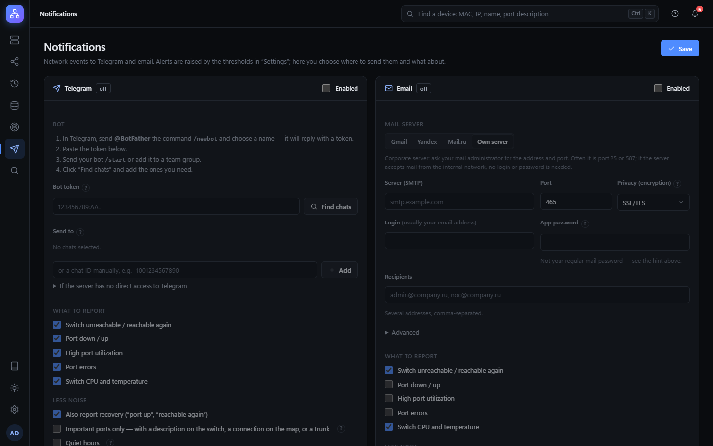<br><sub><b>Notifications</b> — Telegram and email, what to report and when</sub></td>
</tr>
<tr>
<td>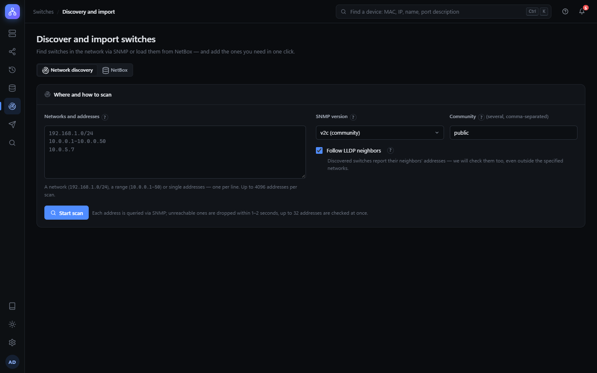<br><sub><b>Discovery</b> — find switches in the network or import them from NetBox</sub></td>
<td>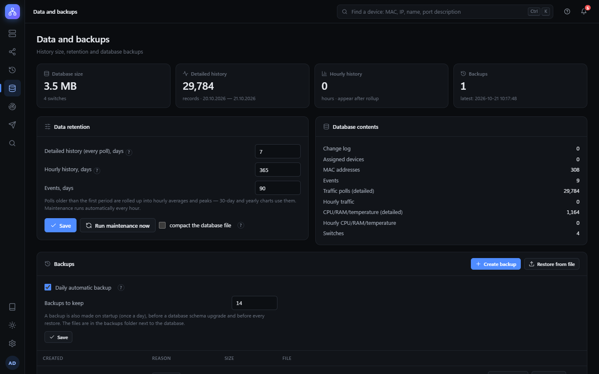<br><sub><b>Data and backups</b> — retention, database maintenance, backups</sub></td>
</tr>
<tr>
<td>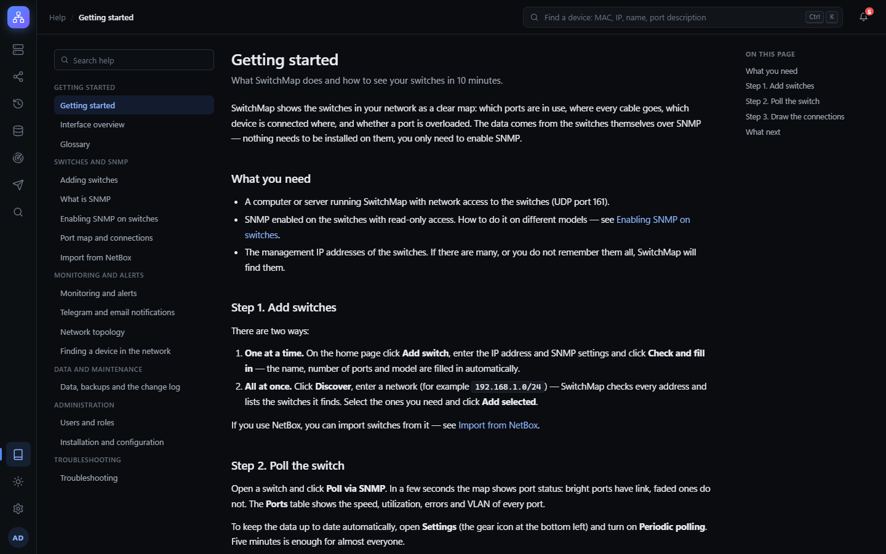<br><sub><b>Built-in help</b> — articles for beginners and administrators</sub></td>
<td>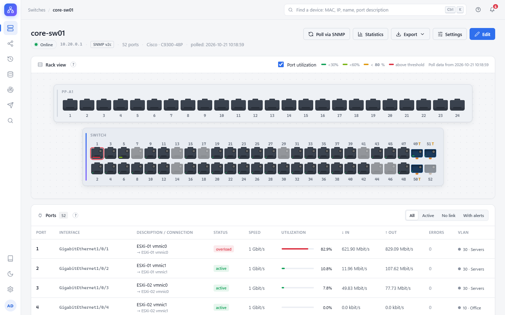<br><sub><b>Light theme</b></sub></td>
</tr>
</table>

<p align="center">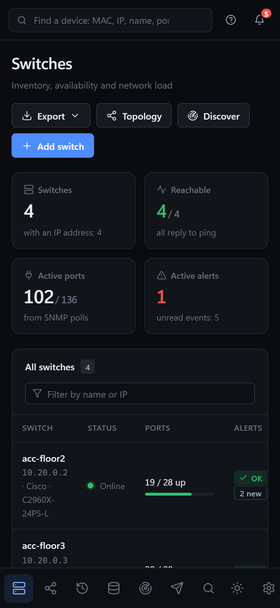<br><sub>On a phone</sub></p>

## Supported equipment

Any managed switch with SNMP and the standard MIBs (IF-MIB, BRIDGE-MIB, Q-BRIDGE-MIB, LLDP-MIB, HOST-RESOURCES-MIB)
works. The built-in help has step-by-step instructions for enabling SNMP on:

Cisco IOS / IOS-XE (Catalyst) · Cisco Business (CBS, SG) · HPE Aruba (ArubaOS-Switch, ProCurve) · HPE Aruba CX ·
HPE Comware / H3C · Juniper (EX, QFX) · MikroTik (RouterOS) · Huawei (S series) · D-Link (DGS, DES) ·
TP-Link (JetStream, Omada) · Eltex (MES) · Ubiquiti UniFi.

Temperature and PoE power are read from vendor MIBs where available (for example, Cisco).

## Installation

Installers are on the **Releases** page. Python and other components are included.

| System | File | How to install |
|---|---|---|
| Windows 10/11, Windows Server 2016+ | `SwitchMap-Setup-X.Y.Z.exe` | run as administrator |
| Debian 12+, Ubuntu 22.04+ | `switchmap_X.Y.Z-1_amd64.deb` | `sudo apt install ./switchmap_X.Y.Z-1_amd64.deb` |
| RHEL, AlmaLinux, Rocky Linux 9+ | `switchmap-X.Y.Z-1.x86_64.rpm` | `sudo dnf install ./switchmap-X.Y.Z-1.x86_64.rpm` |

SwitchMap runs as a service: it starts with the system and restarts after a failure. On Windows the installer asks
whether the web interface should be reachable from the network and opens the firewall port; on Linux the service runs
as a dedicated unprivileged user.

**First steps**
1. Open `http://localhost:5000` (or `http://<server>:5000`) and create the administrator.
2. Enable SNMP on your switches (see **Help → Enabling SNMP on switches**).
3. Add switches one by one with **Add switch → Check and fill in**, or find them all with **Discover**.
4. Turn on **Settings → Periodic polling** and set up notifications.

> [!TIP]
> If users connect from other computers, put SwitchMap behind an HTTPS proxy — the help article
> «Installation and configuration → HTTPS» shows a ready setup with Caddy in four steps.

> [!NOTE]
> The installer is not signed with a paid certificate, so Windows SmartScreen shows «Unknown publisher».
> Click **More info → Run anyway**. Checksums of all files are in `SHA256SUMS.txt` of each release.

## Configuration

Server settings live in `switchmap.conf` (`KEY=value` lines); restart the service after changing it.
Everything else (polling, thresholds, notifications, users, language) is set in the web interface.

| | Windows | Linux |
|---|---|---|
| Settings file | `C:\ProgramData\SwitchMap\switchmap.conf` | `/etc/switchmap/switchmap.conf` |
| Database, keys, backups, log | `C:\ProgramData\SwitchMap` | `/var/lib/switchmap` |
| Restart | `Restart-Service SwitchMap` | `sudo systemctl restart switchmap` |
| Reset a password | `& "C:\Program Files\SwitchMap\switchmap.exe" reset-password admin` | `sudo switchmap reset-password admin` |

| Key | Meaning |
|---|---|
| `SWITCHMAP_HOST` | `127.0.0.1` — this computer only (default); `0.0.0.0` — reachable from the network |
| `SWITCHMAP_PORT` | web interface port, `5000` by default |
| `SWITCHMAP_HTTPS`, `SWITCHMAP_PROXY` | `1` when running behind an HTTPS reverse proxy |
| `SWITCHMAP_DATA` | another data folder |
| `SWITCHMAP_LANG` | default language of the log and notifications (`en`, `ru`, `zh`, `es`, `de`, `fr`) |
| `SWITCHMAP_LOG_LEVEL` | log detail: `DEBUG`, `INFO`, `WARNING` |
| `SWITCHMAP_UPDATE_CHECK` | `0` — never check for new versions (isolated networks) |
| `SWITCHMAP_TELEGRAM_API` | self-hosted Telegram Bot API server |

`switchmap --paths` prints where the database, settings and log are on a given server.

## Updating, backups and moving to another server

- **Update** — install the new version over the old one. Data and settings are kept; a backup is made automatically
  before the database structure changes.
- **Backups** — a copy of the database is made every day (14 are kept by default) and can be downloaded or restored
  from **Data and backups**. Keep copies on another server as well.
- **Moving** — copy `switches.db` and `switchmap.secret` from the data folder to the new server.
  `switchmap.secret` holds the encryption keys of saved passwords; it is not included in backups, keep it separately.

## Documentation

The full guide is built into the application (**Help** in the side menu) and is also available here:
[getting started](help/en/getting-started.md) · [adding switches](help/en/add-switch.md) ·
[enabling SNMP](help/en/snmp-vendors.md) · [port map](help/en/port-map.md) · [monitoring](help/en/monitoring.md) ·
[notifications](help/en/notifications.md) · [topology](help/en/topology.md) · [search](help/en/search.md) ·
[NetBox](help/en/netbox.md) · [backups](help/en/backups.md) · [users](help/en/users.md) ·
[installation](help/en/installation.md) · [troubleshooting](help/en/troubleshooting.md) · [glossary](help/en/glossary.md)

## Development

Python 3.12+ is required.

```
python -m venv venv
venv\Scripts\activate          # Linux: source venv/bin/activate
pip install -r requirements.txt
python app.py
```

When run from source, data is stored in the current folder.

```
python tests/run_all.py          # fast tests
python tests/run_all.py --all    # everything, including the SNMP simulator and browser tests
```

Preparation for the full test run is described in [tests/README.md](tests/README.md);
building installers and releasing — in [packaging/README.md](packaging/README.md).

<details>
<summary>Project structure</summary>

| Path | Contents |
|---|---|
| `app.py` | web application, SNMP polling, scheduler |
| `config.py` | data paths, settings file, logging |
| `security.py` | users, login, CSRF, encryption of secrets |
| `audit.py` | change log and undo |
| `maintenance.py` | history rollup, retention, backups |
| `notify.py` | Telegram and email notifications |
| `discovery.py`, `netbox.py` | network discovery, NetBox integration |
| `updates.py` | new version check |
| `i18n.py`, `locales/` | translations (`python locales/tool.py check`) |
| `helpdocs.py`, `help/` | built-in help, one folder per language |
| `templates/`, `static/` | web interface (`static/vendor` — Chart.js, d3, pdfmake, Noto Sans SC) |
| `packaging/` | Windows installer, deb and rpm packages |
| `tools/screenshots/` | demo network and screenshots for this README |
| `tests/` | tests |

</details>

**Translations.** The source language of the interface is Russian; catalogs are in `locales/<lang>.json`,
help articles in `help/<lang>/`. `python locales/tool.py missing de` lists untranslated strings.
Corrections from native speakers are very welcome.

## License

[MIT](LICENSE). Third-party libraries in `static/vendor` are distributed under their own licenses (files next to them).
