<div align="center">

# SwitchMap

**Учёт коммутаторов и мониторинг сети в одном веб-приложении: схемы портов, SNMP, топология, оповещения.**

[English](README.md) · Русский


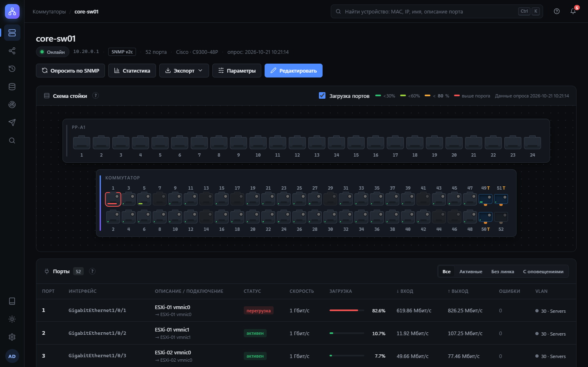

</div>

SwitchMap даёт всегда актуальную картину сети доступа: какое устройство в каком порту, какие порты перегружены
или сыплют ошибками, как коммутаторы связаны между собой и кто что менял.
Приложение опрашивает коммутаторы по SNMP, рисует их такими, какие они в стойке, и присылает оповещения
в Telegram или на почту.

Устанавливается как обычная служба на Windows или Linux, работает без доступа в интернет и не требует
ни сервера баз данных, ни Python, ни других компонентов.

## Содержание

- [Возможности](#возможности)
- [Скриншоты](#скриншоты)
- [Поддерживаемое оборудование](#поддерживаемое-оборудование)
- [Установка](#установка)
- [Настройка](#настройка)
- [Обновление, резервные копии и переезд](#обновление-резервные-копии-и-переезд)
- [Документация](#документация)
- [Разработка](#разработка)
- [Лицензия](#лицензия)

## Возможности

**Схема портов и учёт**
- Коммутаторы и патч-панели нарисованы как в стойке: порты RJ-45 и SFP, в один или два ряда, транки.
- Подключения «порт коммутатора → порт патч-панели → устройство» с цветом кабеля и описанием.
- VLAN на портах с цветами, описания портов с коммутатора (ifAlias), состояние и мощность PoE.
- Выгрузка в Excel, CSV и PDF-паспорт для печати — по коммутатору или по всей сети.

**Мониторинг**
- SNMP v2c и v3 (MD5, SHA-1…SHA-512; DES, 3DES, AES-128/192/256), опрос по расписанию.
- Состояние, скорость, входящий и исходящий трафик, загрузка и ошибки портов; CPU, память и температура коммутатора.
- Графики за период от часа до года: подробные данные хранятся неделю, потом сворачиваются в почасовые средние и пики.
- Оповещения: коммутатор недоступен, порт упал или «мигает», загрузка или ошибки выше порога,
  высокая загрузка CPU или перегрев — и отдельное сообщение, когда всё вернулось в норму.

**Поиск устройств**
- Одна строка поиска по MAC, IP, имени, описанию порта и подписям подключений (<kbd>Ctrl</kbd>+<kbd>K</kbd>).
- Результат — коммутатор и порт; связи между коммутаторами (uplink) распознаются и показываются отдельно.

**Топология**
- Карта сети по LLDP: коммутаторы, связи с номерами портов, неизвестные соседи (точки доступа, межсетевые экраны)
  и устройства, закреплённые за портами.

**Уведомления**
- Telegram (бот, несколько чатов, прокси или свой сервер Bot API) и почта (Gmail, Яндекс, Mail.ru, Outlook или свой SMTP).
- Одно сообщение на опрос, тихие часы, «только важные порты», подавление «мигающих» портов, повтор после ошибок сети.

**Поиск в сети и импорт**
- Сканирование сетей и диапазонов по SNMP, обход соседей по LLDP и добавление найденных коммутаторов в один клик.
- Импорт коммутаторов из NetBox и синхронизация имён и адресов.

**Данные и безопасность**
- Пользователи с ролями «администратор» и «наблюдатель», защита от перебора паролей, CSRF, строгая политика CSP.
- Пароли SNMPv3, почты, Telegram и NetBox хранятся зашифрованными.
- Журнал изменений с отменой: коммутаторы, подключения, настройки, пользователи; удалённый коммутатор можно восстановить.
- Ежедневные резервные копии базы и восстановление в один клик.

**Удобство**
- Интерфейс на шести языках: русском, английском, китайском, испанском, немецком и французском —
  выбирается по языку системы, меняется в меню профиля и в настройках.
- Встроенная база знаний (16 статей на каждом языке) и подсказки «?» у полей: что такое SNMP, как включить его
  на коммутаторе конкретного производителя, что делать, если что-то не работает.
- Тёмная и светлая темы, работает на телефоне и планшете.
- Ежедневная проверка новых версий (отключается; ничего не скачивается и не устанавливается само).

## Скриншоты

<table>
<tr>
<td width="50%">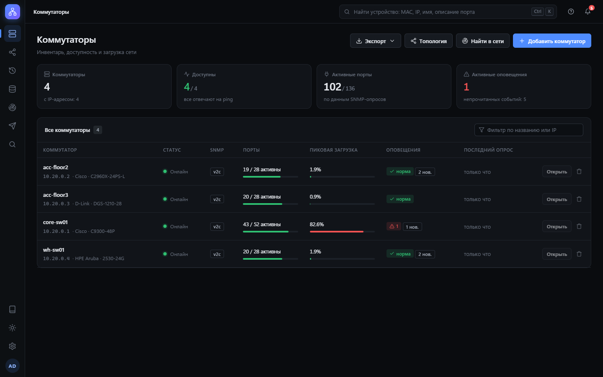<br><sub><b>Главная</b> — доступность, активные порты, пиковая загрузка и оповещения всех коммутаторов</sub></td>
<td width="50%">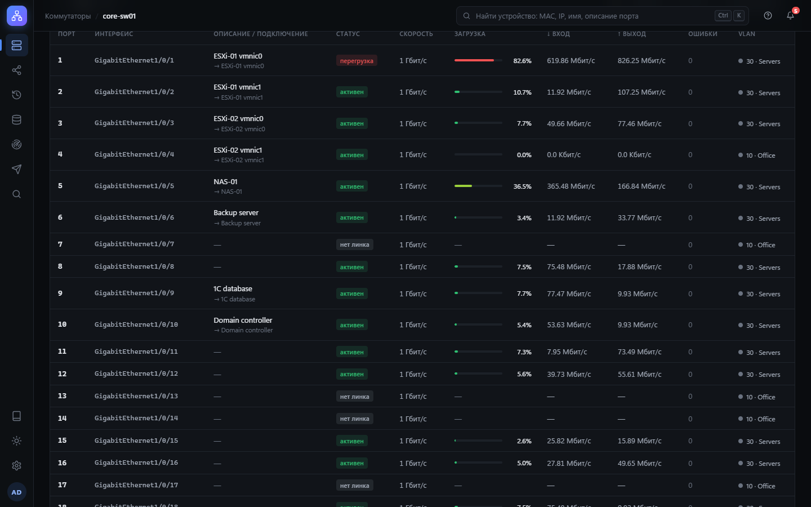<br><sub><b>Таблица портов</b> — состояние, скорость, трафик, загрузка, ошибки и VLAN каждого порта</sub></td>
</tr>
<tr>
<td>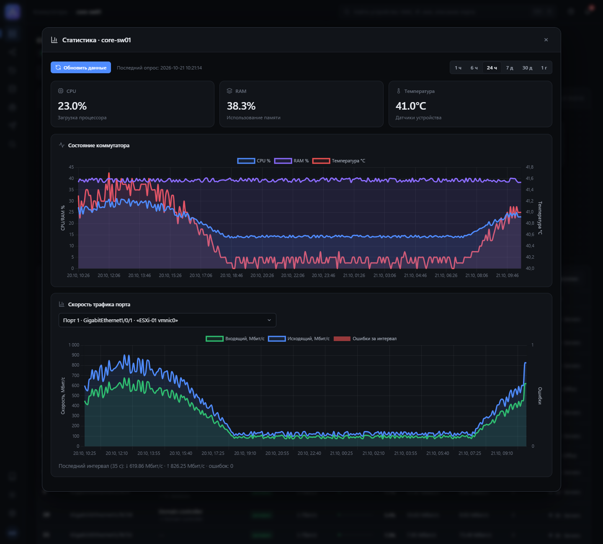<br><sub><b>Статистика</b> — CPU, память, температура и трафик порта во времени</sub></td>
<td>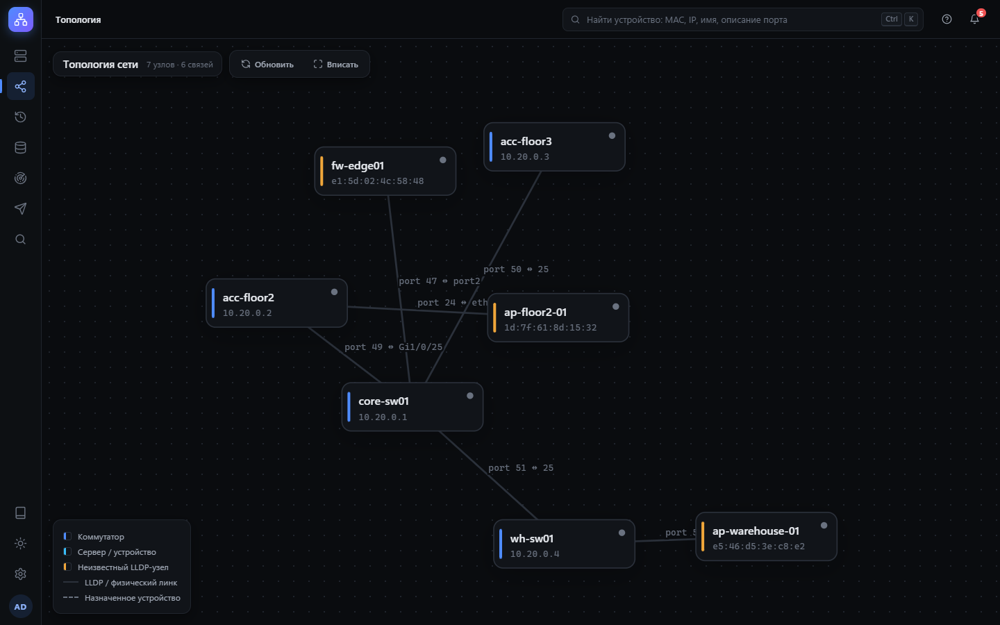<br><sub><b>Топология</b> — связи LLDP между коммутаторами и неизвестные соседи</sub></td>
</tr>
<tr>
<td>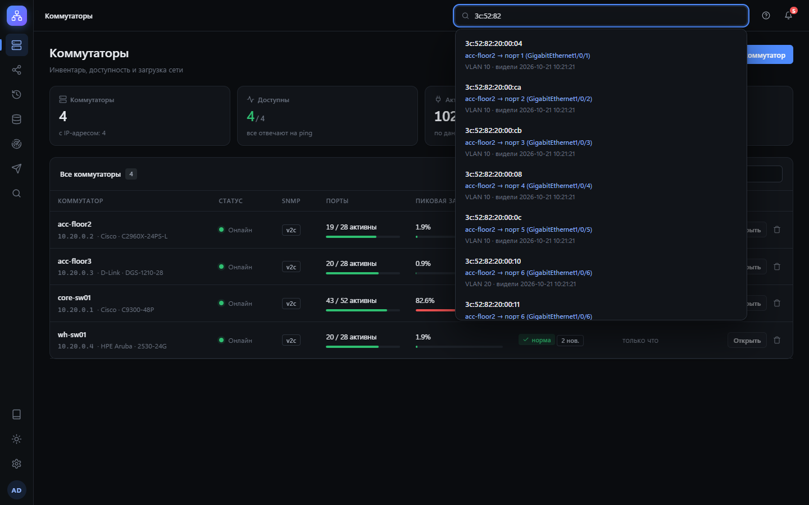<br><sub><b>Поиск</b> — где подключён MAC, IP или имя</sub></td>
<td>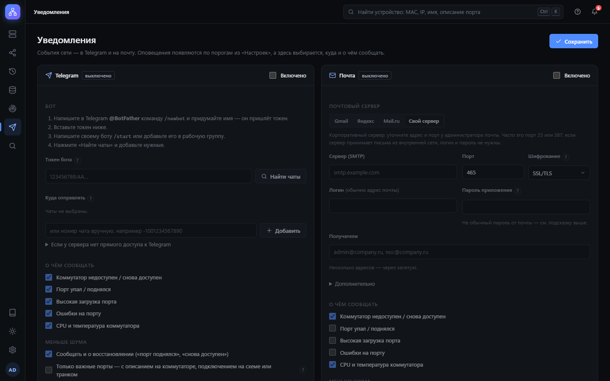<br><sub><b>Уведомления</b> — Telegram и почта, о чём и когда сообщать</sub></td>
</tr>
<tr>
<td>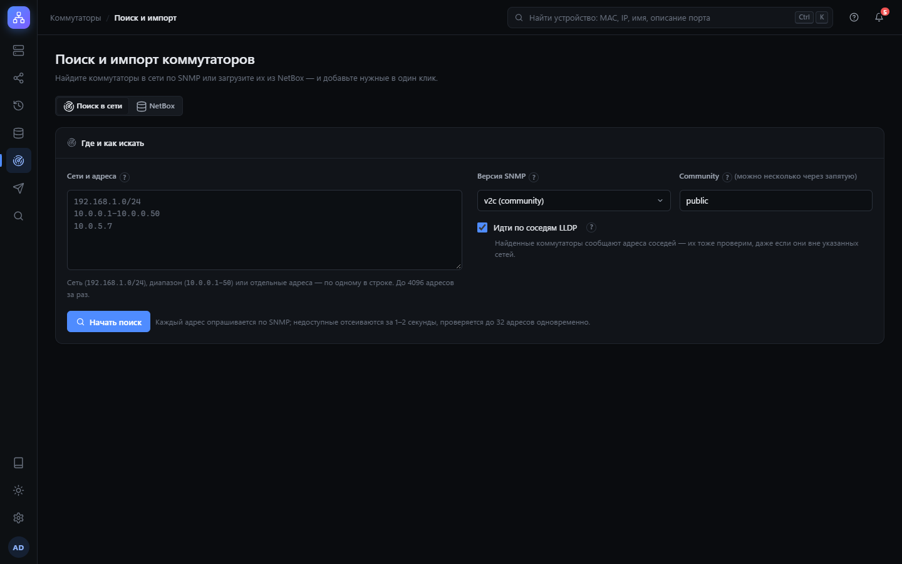<br><sub><b>Поиск в сети</b> — найти коммутаторы или импортировать их из NetBox</sub></td>
<td>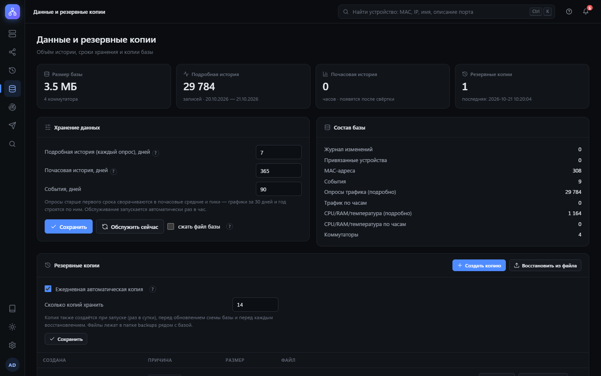<br><sub><b>Данные и резервные копии</b> — сроки хранения, обслуживание базы, копии</sub></td>
</tr>
<tr>
<td>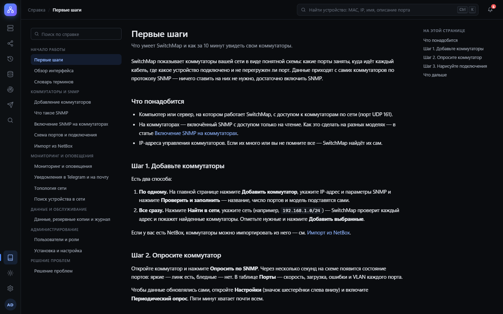<br><sub><b>Встроенная справка</b> — статьи для новичков и администраторов</sub></td>
<td>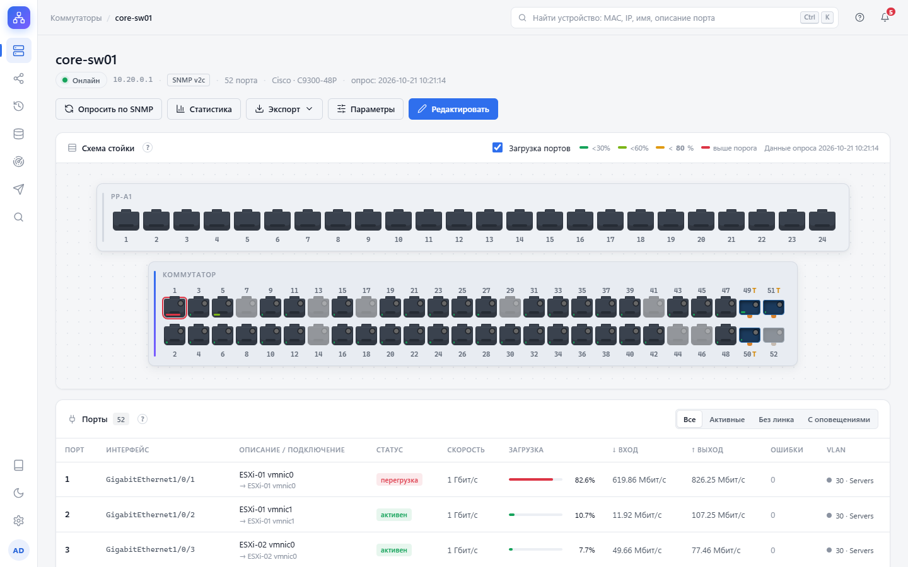<br><sub><b>Светлая тема</b></sub></td>
</tr>
</table>

<p align="center">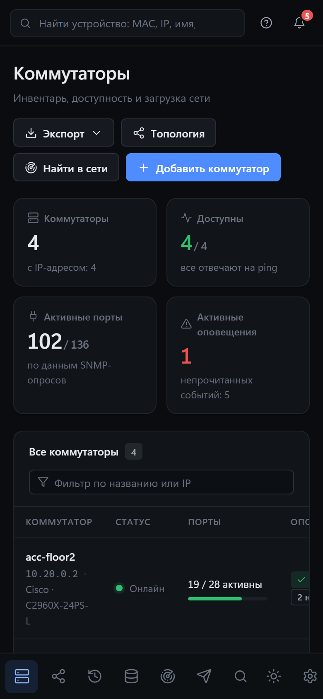<br><sub>На телефоне</sub></p>

## Поддерживаемое оборудование

Подходит любой управляемый коммутатор с SNMP и стандартными MIB (IF-MIB, BRIDGE-MIB, Q-BRIDGE-MIB, LLDP-MIB,
HOST-RESOURCES-MIB). Во встроенной справке есть пошаговые инструкции по включению SNMP для:

Cisco IOS / IOS-XE (Catalyst) · Cisco Business (CBS, SG) · HPE Aruba (ArubaOS-Switch, ProCurve) · HPE Aruba CX ·
HPE Comware / H3C · Juniper (EX, QFX) · MikroTik (RouterOS) · Huawei (серия S) · D-Link (DGS, DES) ·
TP-Link (JetStream, Omada) · Eltex (MES) · Ubiquiti UniFi.

Температура и мощность PoE читаются из MIB производителя, где они есть (например, у Cisco).

## Установка

Установщики — на странице **Releases**. Python и другие компоненты уже внутри.

| Система | Файл | Как установить |
|---|---|---|
| Windows 10/11, Windows Server 2016+ | `SwitchMap-Setup-X.Y.Z.exe` | запустить от имени администратора |
| Debian 12+, Ubuntu 22.04+ | `switchmap_X.Y.Z-1_amd64.deb` | `sudo apt install ./switchmap_X.Y.Z-1_amd64.deb` |
| RHEL, AlmaLinux, Rocky Linux 9+ | `switchmap-X.Y.Z-1.x86_64.rpm` | `sudo dnf install ./switchmap-X.Y.Z-1.x86_64.rpm` |

SwitchMap работает как служба: запускается вместе с системой и перезапускается после сбоя. На Windows установщик
спрашивает, открывать ли веб-интерфейс из сети, и сам открывает порт в брандмауэре; на Linux служба работает
от отдельного пользователя без лишних прав.

**Первые шаги**
1. Откройте `http://localhost:5000` (или `http://<сервер>:5000`) и создайте администратора.
2. Включите SNMP на коммутаторах (**Справка → Включение SNMP на коммутаторах**).
3. Добавьте коммутаторы по одному — **Добавить коммутатор → Проверить и заполнить** — или найдите все сразу через **Найти в сети**.
4. Включите **Настройки → Периодический опрос** и настройте уведомления.

> [!TIP]
> Если к SwitchMap подключаются с других компьютеров, поставьте перед ним HTTPS-прокси: в справке
> «Установка и настройка → HTTPS» есть готовая настройка Caddy в четыре шага.

> [!NOTE]
> Установщик не подписан платным сертификатом, поэтому Windows SmartScreen покажет «Неизвестный издатель».
> Нажмите **Подробнее → Выполнить в любом случае**. Контрольные суммы файлов — в `SHA256SUMS.txt` каждого релиза.

## Настройка

Параметры сервера — в файле `switchmap.conf` (строки `КЛЮЧ=значение`); после изменения перезапустите службу.
Всё остальное (опрос, пороги, уведомления, пользователи, язык) настраивается в веб-интерфейсе.

| | Windows | Linux |
|---|---|---|
| Файл настроек | `C:\ProgramData\SwitchMap\switchmap.conf` | `/etc/switchmap/switchmap.conf` |
| База, ключи, копии, журнал | `C:\ProgramData\SwitchMap` | `/var/lib/switchmap` |
| Перезапуск | `Restart-Service SwitchMap` | `sudo systemctl restart switchmap` |
| Сброс пароля | `& "C:\Program Files\SwitchMap\switchmap.exe" reset-password admin` | `sudo switchmap reset-password admin` |

| Ключ | Значение |
|---|---|
| `SWITCHMAP_HOST` | `127.0.0.1` — только этот компьютер (по умолчанию); `0.0.0.0` — доступ из сети |
| `SWITCHMAP_PORT` | порт веб-интерфейса, по умолчанию `5000` |
| `SWITCHMAP_HTTPS`, `SWITCHMAP_PROXY` | `1` — работа за HTTPS-прокси |
| `SWITCHMAP_DATA` | другая папка данных |
| `SWITCHMAP_LANG` | язык журнала и уведомлений по умолчанию (`ru`, `en`, `zh`, `es`, `de`, `fr`) |
| `SWITCHMAP_LOG_LEVEL` | подробность журнала: `DEBUG`, `INFO`, `WARNING` |
| `SWITCHMAP_UPDATE_CHECK` | `0` — не проверять новые версии (закрытая сеть) |
| `SWITCHMAP_TELEGRAM_API` | свой сервер Telegram Bot API |

`switchmap --paths` показывает, где на конкретном сервере лежат база, настройки и журнал.

## Обновление, резервные копии и переезд

- **Обновление** — установите новую версию поверх старой. Данные и настройки сохраняются, перед изменением
  устройства базы автоматически делается резервная копия.
- **Резервные копии** — копия базы делается каждый день (по умолчанию хранятся 14), их можно скачать или восстановить
  в разделе **Данные и резервные копии**. Храните копии и на другом сервере.
- **Переезд** — перенесите `switches.db` и `switchmap.secret` из папки данных на новый сервер.
  В `switchmap.secret` — ключи шифрования сохранённых паролей; в резервные копии он не входит, храните его отдельно.

## Документация

Полное руководство встроено в приложение (**Справка** в боковом меню) и доступно здесь:
[первые шаги](help/ru/getting-started.md) · [добавление коммутаторов](help/ru/add-switch.md) ·
[включение SNMP](help/ru/snmp-vendors.md) · [схема портов](help/ru/port-map.md) · [мониторинг](help/ru/monitoring.md) ·
[уведомления](help/ru/notifications.md) · [топология](help/ru/topology.md) · [поиск](help/ru/search.md) ·
[NetBox](help/ru/netbox.md) · [резервные копии](help/ru/backups.md) · [пользователи](help/ru/users.md) ·
[установка](help/ru/installation.md) · [решение проблем](help/ru/troubleshooting.md) · [словарь терминов](help/ru/glossary.md)

## Разработка

Нужен Python 3.12 или новее.

```
python -m venv venv
venv\Scripts\activate          # Linux: source venv/bin/activate
pip install -r requirements.txt
python app.py
```

При запуске из исходников данные хранятся в текущей папке.

```
python tests/run_all.py          # быстрые тесты
python tests/run_all.py --all    # все, включая SNMP-симулятор и проверки в браузере
```

Подготовка к полному прогону тестов — в [tests/README.md](tests/README.md);
сборка установщиков и выпуск релиза — в [packaging/README.md](packaging/README.md).

<details>
<summary>Структура проекта</summary>

| Путь | Что внутри |
|---|---|
| `app.py` | веб-приложение, SNMP-опрос, планировщик |
| `config.py` | пути к данным, файл настроек, журнал |
| `security.py` | пользователи, вход, CSRF, шифрование секретов |
| `audit.py` | журнал изменений и откат |
| `maintenance.py` | свёртка истории, сроки хранения, резервные копии |
| `notify.py` | уведомления в Telegram и на почту |
| `discovery.py`, `netbox.py` | поиск в сети, интеграция с NetBox |
| `updates.py` | проверка новых версий |
| `i18n.py`, `locales/` | переводы (`python locales/tool.py check`) |
| `helpdocs.py`, `help/` | встроенная справка, папка на каждый язык |
| `templates/`, `static/` | веб-интерфейс (`static/vendor` — Chart.js, d3, pdfmake, Noto Sans SC) |
| `packaging/` | установщик Windows, пакеты deb и rpm |
| `tools/screenshots/` | демо-сеть и скриншоты для этого README |
| `tests/` | тесты |

</details>

**Переводы.** Исходный язык интерфейса — русский; каталоги — `locales/<язык>.json`, статьи справки — `help/<язык>/`.
`python locales/tool.py missing de` покажет непереведённые строки. Правки от носителей языка очень приветствуются.

## Лицензия

[MIT](LICENSE). Сторонние библиотеки в `static/vendor` распространяются под своими лицензиями (файлы рядом с ними).
